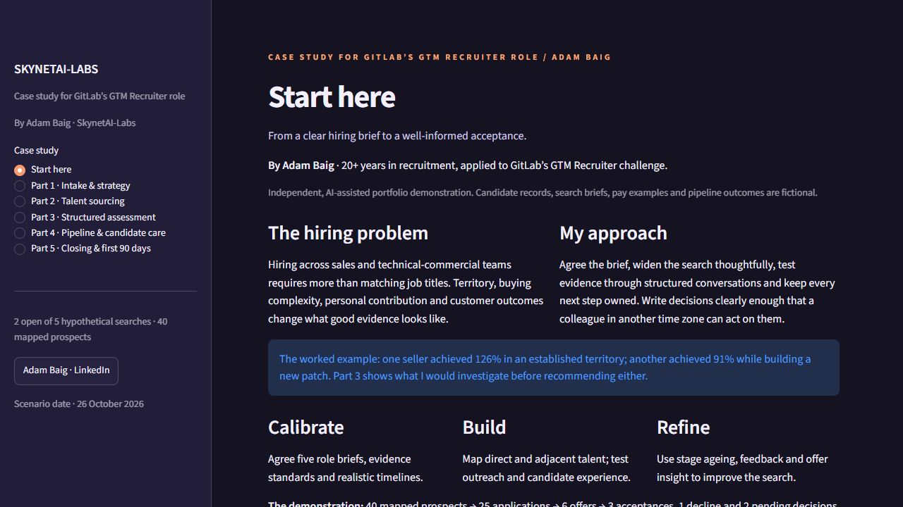

# SkynetAI-Labs · GTM Recruiting Case Study

By Adam Baig. A five-part case study for GitLab™’s Recruiter, GTM role.

GITLAB is a trademark of GitLab Inc. in the United States and other countries and regions.

**[Open the live case study](https://skynetai-recruiting-case-study.streamlit.app/)**

## Explore
- Intake and strategy: five role briefs and interviewer responsibilities.
- Talent sourcing: 40 fictional profiles and balanced channels.
- Structured assessment: contextual AE quota comparison and five interview kits.
- Pipeline and candidate care: 25 applications, action owners, documented stage changes and downloadable notes.
- Closing and first 90 days: illustrative OTE, candidate communication and an executive summary.



## Run
Python 3.12:
```
python -m venv .venv
.venv\Scripts\python -m pip install -r requirements.txt
.venv\Scripts\python -m streamlit run streamlit_app.py --server.port 8502
```
Open http://127.0.0.1:8502/ on the same computer for local use.

Run checks with `python -m pytest -q`.

## Data and method
All candidate records, role briefs, pay examples and pipeline outcomes are fictional. Five single-seat searches have six historical offers: three accepted, one declined and two pending on the remaining two searches. Stages are cumulative; source prospects are separate from applications. Each visitor’s edits remain in their own session and reset when that session ends. Export notes before leaving if needed.

The comparison does not rank or automatically select candidates. Interview evidence and recruiter review drive the demonstration. The OTE calculator is a simple linear illustration, not a GitLab compensation plan. No candidate data is sent to a language model, and no Greenhouse connection is provided.

## Research
Reviewed 26 October 2026:
- Official vacancy: https://job-boards.greenhouse.io/gitlab/jobs/8869149002
- Communication: https://handbook.gitlab.com/handbook/communication/
- Remote meetings: https://handbook.gitlab.com/handbook/company/culture/all-remote/meetings/

The five role families come from the vacancy. The briefs, workflow and targets are Adam’s proposed approach. The US recruiter salary range is not a UK sales pay benchmark. Third-party LinkedIn headcount and applicant estimates were excluded.

Independent portfolio demonstration; no GitLab affiliation or endorsement.

[Adam Baig on LinkedIn](https://www.linkedin.com/in/adambaiguk)

## Review resources
[Executive brief](docs/executive-brief.md) · [Interview kits](docs/interview-kits.md) · [Audit guide](docs/audit-guide.md)

On Windows, Start-Demo.ps1 creates a Python 3.12 environment if needed and opens the app on port 8502. See the manual commands above if PowerShell blocks scripts.


## Related project
[My GitLab DevSecOps project](https://gitlab.com/SkynetAI-Labs/gitlab-secure-cicd-pipeline) · [GitLab profile](https://gitlab.com/SkynetAI-Labs)
